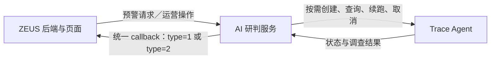
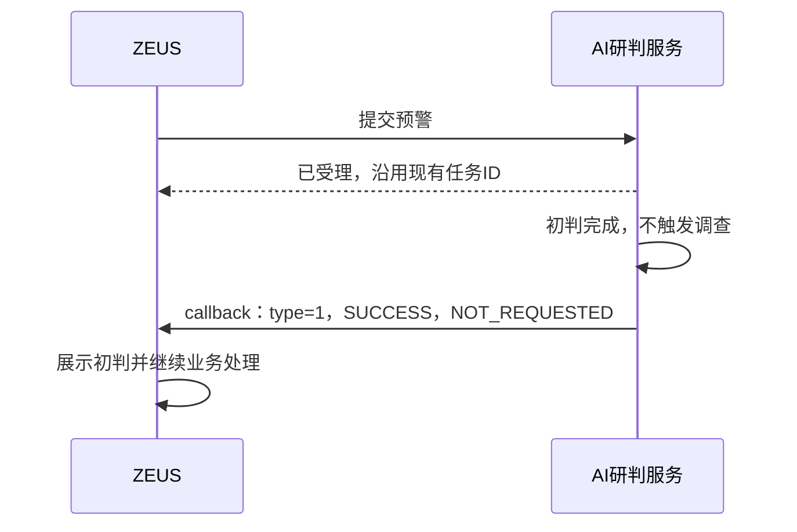
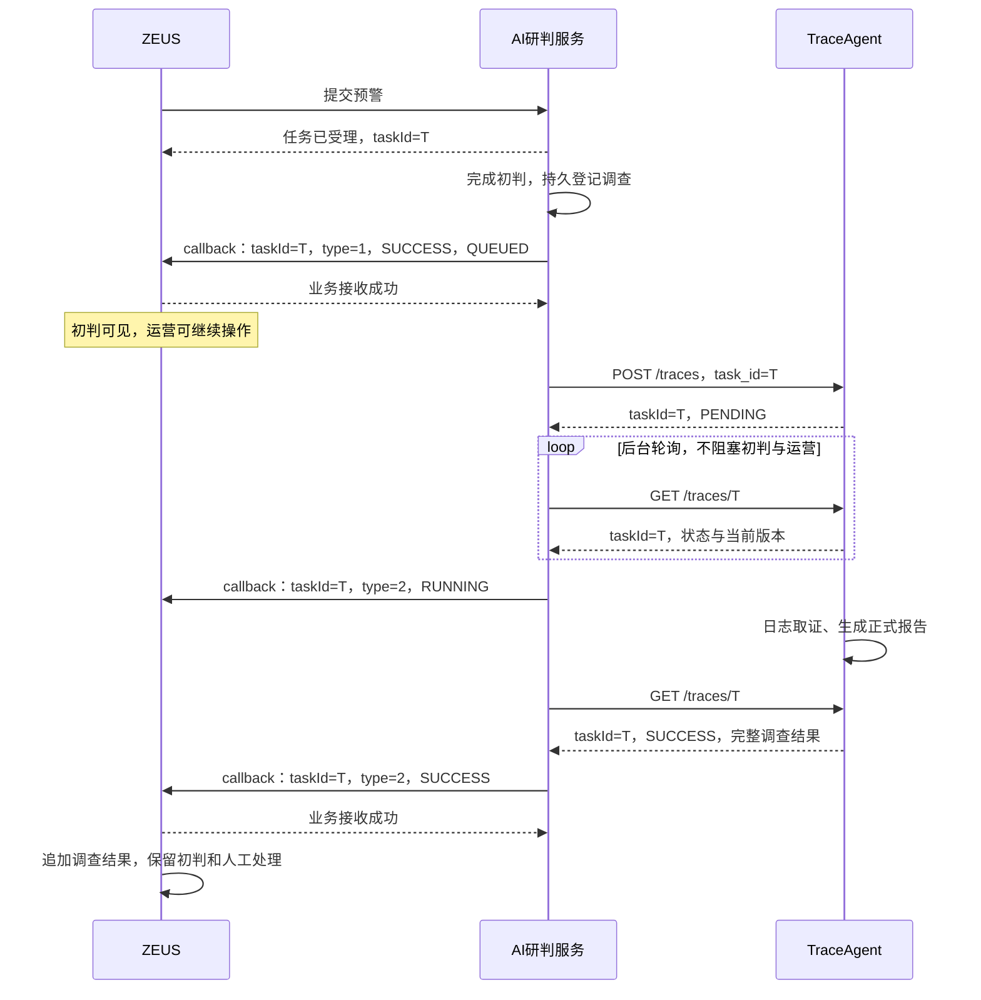
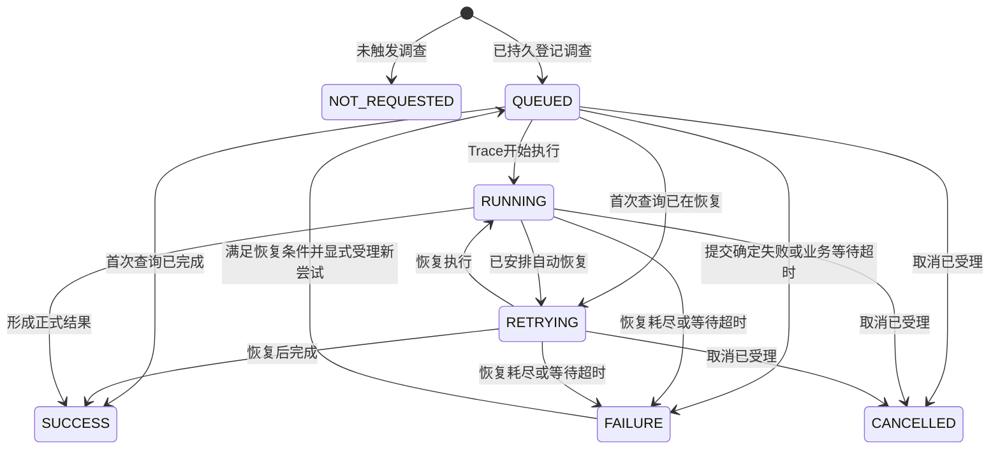

# ZEUS、AI 研判服务与 Trace Agent 三方交互流程与接口约定

版本：V1.0 联调评审稿\
日期：2026-11-05\
读者：ZEUS 后端与前端同事、AI 研判服务开发同事、Trace Agent 开发同事

本文约定一条预警从 AI 初判、按需后台调查到结果回填的完整流程。目标是：**初判完成立即可见，运营可以继续处理；只有选中的预警进入 Trace 调查，调查结束后再补充结果。**

ZEUS 只对接 AI 研判服务。AI 研判服务负责调用 Trace Agent，并统一向 ZEUS 发送 callback。三方在同一次业务任务中使用同一个 `taskId`。运营人员不需要查询、复制或填写任务编号。

本文是目标接口与开发分工约定，不表示现有生产代码已经支持全部行为。文中“已确认”指已经明确的业务要求；“联调新增建议”指为实现这些要求提出的字段或技术规则，须由相关开发方在联调时落实。

先用一句话理解：**ZEUS 发起一次任务 → 我方先交付初判 → 有需要才在后台调用 Trace → 我方把调查进度和报告补回同一任务；运营始终可以继续处理。**

## 阅读导航

| 读者 | 建议先看 | 开发时重点看 |
|---|---|---|
| 所有人 | 第 1～5 节，理解边界、任务身份和时序 | 第 17 节，确认待落实事项 |
| ZEUS 后端 | 第 4、9、10、12 节 | 第 11、13、15、16 节 |
| ZEUS 前端 | 第 5、10、12 节 | 第 16 节的页面验收案例 |
| AI 研判服务 | 第 5～11 节 | 第 13～17 节 |
| Trace Agent | 第 4、7、8 节 | 第 11、13、15～17 节 |

文中的 ID、预警名称、时间和结论均为接口示例，不是实际调查结果。JSON 示例可独立解析；“相关字段示例”不代替现有接口的全部业务字段。

## 1. 已确认的业务要求

1. **初判完成立即回填。** 不等待 Trace 的创建请求、排队或约十分钟的调查过程；“约十分钟”是业务背景，不是接口超时或完成时限承诺。
2. **第一次研判 callback 明确返回 `type=1`。** 后续调查进度、结果或失败 callback 返回 `type=2`。
3. **三方共用同一个 `taskId`。** Trace 接收上游传入的 ID，不再生成另一套对外调查任务 ID。
4. **Trace 按需调用。** 触发来源是新行为、抽样、AI 决定调查；没有触发就不创建 Trace 任务。
5. **初判和调查分别显示。** “初判已成功”和“小溯源调查中”可以同时成立。
6. **两类结果统一由 AI 研判服务回调 ZEUS。** Trace 不直接调用 ZEUS，也不持有 ZEUS callback 凭证。
7. **四类分类共用一套含义。** Trace 的 `verdict` 取值属于“风险属实、正常行为、检测误报、待核实”的集合，由 AI 研判服务转换成 ZEUS 的 `tag`。
8. **分类、关联、处置分别表达。** `tag` 不直接等于“忽略／转交”；同事件关联不等于误报；任务成功不等于处置执行成功。
9. **人工确认独立保存。** AI 或 Trace 迟到的结果不得覆盖人工确认、人工关联和既有处置记录。
10. **运营不被调查阻塞。** 调查排队或运行期间，仍可查看初判、人工确认、转交及处理预警。

本方案不增加“必须等待 Trace 后才能转交”的条件。是否自动转交继续执行 ZEUS 已有业务规则，并应用第 12 节约定的同事件重复转交检查。

## 2. 三方职责和系统边界

### 2.1 职责表

| 职责 | ZEUS | AI 研判服务 | Trace Agent |
|---|---|---|---|
| 提供预警及原始事实 | 负责 | 接收、保留来源 | 接收调查所需事实 |
| 初次 AI 研判 | 展示结果 | 负责 | 不参与每条预警的初判 |
| 决定是否启动自动调查 | 提供业务配置或用户入口 | 负责触发判断、抽样、调用预算 | 不自行从 ZEUS 拉取全部预警 |
| 提供待核实问题 | 可补充人工问题 | 整理为 `evidence_gaps` | 根据问题开展取证 |
| 调查执行及内部恢复 | 展示进度 | 提交并跟踪 | 负责日志查询、报告和内部自动恢复 |
| 向 ZEUS 回填 | 接收 | 唯一对外发送方 | 只向 AI 研判服务返回查询结果 |
| 验证同事件主预警是否已承接 | 负责 | 提供关联建议及依据 | 首版不要求输出关联建议 |
| 人工确认及业务状态 | 负责 | 不覆盖 | 不覆盖 |
| 实际转交、封堵、隔离记录 | 由现有业务与执行系统管理 | 保留现有执行边界和记录 | 本次接入不执行这些动作 |
| 防重复调查 | 可避免重复点击 | 统一任务登记和调度去重 | 同 `task_id` 创建幂等 |
| callback 补投 | 幂等接收并确认持久化 | 负责 | 不负责 ZEUS 投递 |

“AI 研判服务”指当前与 ZEUS 对接的服务；业务分析可以来自当前生产研判流程或后续 SOC Runtime，但对外统一由这一层适配。本文不要求为了接 Trace 重建现有研判框架。

### 2.2 只存在两条跨系统接口边界



ZEUS 不轮询 Trace、不理解其内部 Celery 状态，也不直接调用 Trace 的恢复或取消接口。Trace 不组装 ZEUS 的处置对象，不调用原 `alert_agent` 流程。

## 3. 术语和五种独立状态

| 概念 | 含义 | 示例 |
|---|---|---|
| 预警 | ZEUS 的业务对象 | `alert_id="100002"` |
| 业务任务 | 一次预警处理请求，可能包含初判和调查 | 三方统一的 `taskId` |
| 初判阶段 | 本次任务的 AI 研判 | `type=1` |
| 调查阶段 | 同一次任务的按需小溯源 | `type=2` |
| callback | 我方向 ZEUS 发送的状态或结果消息 | `POST /public/alertModelCallback` |
| Gap | 本次希望调查核实的具体问题 | “该次登录是否获得授权” |
| 尝试 | 同阶段执行失败后的恢复过程 | 系统内部记录，不让运营输入编号 |

不能用一个总状态同时覆盖下面五种含义：

| 状态维度 | 维护方 | 例子 |
|---|---|---|
| 初判任务状态 | AI 研判服务，ZEUS 保存投影 | 已受理、处理中、成功、失败 |
| 调查任务状态 | Trace 维护，我方同步，ZEUS 展示 | 未发起、排队、调查中、恢复中、成功、失败、取消 |
| callback 投递状态 | AI 研判服务 | 待发送、等待重试、已确认接收、投递异常 |
| AI 分类 | 初判或 Trace 产出，ZEUS 分来源保存 | 风险属实、正常行为、检测误报、待核实 |
| 人工确认及业务处理状态 | ZEUS 与实际执行系统 | 人工已确认、已转交、已承接、已关闭、处置执行失败 |

例如，以下情况完全合理：

```text
初判：成功，分类为待核实
调查：运行中
业务：已经转交，运营正在跟进
```

`SUCCESS + 待核实` 表示任务成功形成了“目前仍不能确认”的结论；`FAILURE` 表示该阶段没有形成可交付的正常结果。两者不能互相替代。

## 4. 统一任务身份和结果类型

### 4.1 三方使用同一个 taskId

沿用 ZEUS 与 AI 研判服务已经建立的任务 ID 分配及返回关系。本次接入不改变已有任务 ID 的分配方。

```text
ZEUS 已关联的任务 ID          11111111-1111-4111-8111-111111111111
AI 研判服务的业务任务 ID      11111111-1111-4111-8111-111111111111
提交给 Trace 的 task_id       11111111-1111-4111-8111-111111111111
Trace 返回的 taskId           11111111-1111-4111-8111-111111111111
两类 callback 的 taskId       11111111-1111-4111-8111-111111111111
```

这里的 `taskId` 是同一次任务，不是 `alert_id`。同一预警以后重新发起一项独立研判任务时，仍按现有入口产生新业务任务 ID；新任务在三方之间同样保持一致。

**网络重传、自动恢复、同输入的显式失败重试，不换本次 `taskId`。** 已成功任务如需更换告警内容或调查问题重新调查，应作为新的业务任务登记，不能覆盖原任务输入。

不新增 `investigation_task_id`。队列投递编号、执行租约和尝试次数可以内部存在，但不能拿来替换三方对外约定的 `taskId`。

### 4.2 type 的位置和含义

`type` 放在：

```text
result.analysis_result.type
```

| 值 | 含义 | 接收规则 |
|---|---|---|
| 数字 `1` | AI 初判 | 新版初判必须显式返回 |
| 数字 `2` | Trace 调查进度或结果 | 新版调查必须显式返回 |
| 缺省、`null`、空字符串 | 兼容旧版初判 | 仅作为旧协议兼容，解释为 1 |
| 其他值 | 未约定类型 | 返回协议错误，不默认为初判 |

建议只接受数字 `1/2`；字符串 `"1"/"2"` 是否兼容，在 ZEUS 接收端统一处理，不由各模块各自猜测。

`type` 不替代原有 `executeType`，两者没有枚举对应关系。

### 4.3 以 taskId 和 type 区分阶段

ZEUS 与 AI 研判服务至少按 `(taskId, type)` 区分阶段记录。在多租户或多环境部署中，还应带上由服务端确定的租户、环境边界。

```text
(T, 1) = 初判 SUCCESS
(T, 2) = 调查 RUNNING
```

不能仅按 `taskId` 设置一个“已经完成”标记，然后拒绝后续 type=2；也不能把 type=2 的 RUNNING 写进初判状态。

## 5. 完整交互流程

### 5.1 普通预警，不调用 Trace

1. ZEUS 按现有入口提交预警。
2. AI 研判服务登记任务，返回受理响应。这个响应仍是“任务已受理”，不是最终研判结果。
3. AI 研判完成，形成四类分类、理由、处理建议，以及有依据的同事件关联建议。
4. 我方判断本次不需要调查。
5. 保存初判结果及待发送 callback，立即回调 `type=1, status=SUCCESS`，`investigation_status=NOT_REQUESTED`。
6. ZEUS 展示初判，执行原有业务流程。
7. 本次没有 Trace 创建、查询和 type=2 callback。



### 5.2 选中调查的预警，初判立即交付

1. 完成初判，判断命中新行为、抽样或 AI 调查条件。
2. 我方在本地可靠保存初判结果、调查输入快照、待执行调查任务及第一次 callback。
3. 立即投递第一次 callback：同一 `taskId`，`type=1, status=SUCCESS, investigation_status=QUEUED`。
4. ZEUS 展示初判和“调查已排队”。运营可以继续处理。
5. 独立后台调度器向 Trace `POST /traces`，传入同一 ID、原始告警与待核实问题。
6. Trace 登记任务并返回 `PENDING`；我方记录已受理，继续后台查询。
7. Trace 进入 `RUNNING`，我方向 ZEUS 回调 `type=2, status=RUNNING, investigation_status=RUNNING`。
8. 如 Trace 自动恢复，回调仍为 `type=2, status=RUNNING`，调查细分状态改为 `RETRYING`。
9. Trace 完成，GET 一次取得正式报告及结果。我方核验任务身份、分类和结果字段，持久保存。
10. 我方向 ZEUS 回调 `type=2, status=SUCCESS, investigation_status=SUCCESS`，追加调查报告。



后台调查可以与 callback 投递并行；图中展示的是逻辑关系。**调用 Trace 不得放在初判结果返回前的阻塞步骤里。** 初判中的 QUEUED 必须对应一个已持久保存、可在重启后继续派发的任务，不能只设置内存标记。

### 5.3 调查最终失败

1. 初判已经成功，调查随后失败。
2. Trace 自动恢复未耗尽时，我方继续跟踪同一个任务。
3. 自动恢复已耗尽且没有后续自动恢复安排时，Trace 返回 `FAILED`。
4. 我方回调 `type=2, status=FAILURE, investigation_status=FAILURE`，附简短错误码和说明。
5. ZEUS 显示“小溯源失败，可重试”，保留初判、同事件有效关联和人工处理记录。

调查失败不会把 `(taskId, 1)` 从 SUCCESS 改为 FAILURE，也不会重新运行初判的封堵或转交流程。

### 5.4 调查期间运营已经确认、转交或关闭预警

调查继续按已登记任务执行，除非运营通过明确的取消操作停止调查。报告回填时，ZEUS 重新检查当前人工状态：

- 已人工确认：报告作为辅助结果保存，不覆盖人工分类。
- 已转交：补充到原预警及关联跟进记录，不重复创建跟进任务。
- 已关闭：追加报告和更新提示，不自动重新打开预警。
- 调查结论与人工结论存在分歧：显示分歧提醒，由既有复核流程处理。

不能仅依靠“开始研判时检查过人工状态”保证安全；人工可能在十分钟调查期间完成处理，必须在 ZEUS 实际应用 callback 时再次保护人工结果。

## 6. 按需调查触发与资源控制

### 6.1 三类自动触发来源

| 来源 | 我方记录的依据 | 注意事项 |
|---|---|---|
| 新行为 | 本次行为特征、已有经验覆盖情况、需要查证的问题 | 规则号相同不代表行为相同；未命中经验也不必然意味着新行为 |
| 抽样 | 抽样策略、选中原因、抽样目标 | 抽样是质检用途，不能据此改写原分类 |
| AI 决定 | 明确的调查需求、问题清单、预期补充证据 | 模型提出的需求受统一开关、并发、预算和去重控制 |

同一任务同时命中多个条件，只启动一次调查，合并并保留触发原因。不能为“新行为”“抽样”“AI 提议”分别各开一个 Trace。

### 6.2 待核实不是强制调用条件

`tag=待核实` 描述当前分类，不直接等于“必须调查”。例如，当前日志源无法提供所需证据、调查预算不足或未选中抽样，都可能不启动 Trace。

反过来，初判为风险属实、正常行为或检测误报，也可以被抽样选中调查。分类和调用选择是独立字段与独立决策。

### 6.3 调查问题的生成

我方输出具体事实问题，而不是要求 Trace 证明已有结论。例如：

```text
核查该次登录是否存在可验证的授权记录。
核查登录前后同一账号是否出现异常操作或关联告警。
```

不要写成“证明这是正常行为”“确认本次一定是误报”。原始告警事实、初判观点和待核实问题要区分来源。

`evidence_gaps` 不绑定 `analysis_run.analysis.evidence_gaps` 这一内部路径。该路径可用于 SOC Runtime 的适配，但当前生产 `sec_know_model` 包尚无同名字段；生产接入方需显式产出问题清单。

### 6.4 并发与等待

初判和 Trace 使用独立的调度并发设置，不能让长时间调查占满初判执行槽位。调查仍共享其应受的全局模型、日志查询和服务端预算。

| 参数 | 负责方 | 本文约定 |
|---|---|---|
| 调查提交／运行并发 | 我方与 Trace | 可配置，联调确定，不写死为初判并发 |
| 查询间隔 | 我方 | 可从 5～10 秒开始，等待较长时退避并加抖动；不是每次查询都 callback |
| 单次 HTTP 超时 | 我方 | 只限制一次网络操作，不等于整个调查时限 |
| 自动恢复额度 | Trace | 配置明确，耗尽后形成 FAILED |
| 调查业务等待时限 | 我方与业务方 | 必须配置，联调根据实际耗时确定；不能拿“约十分钟”直接当超时值 |
| callback 重试和告警 | 我方 | 有界退避、持久待投递、耗尽后可人工补投，不丢弃结果 |

## 7. 接口总览与输入身份

### 7.1 接口归属

| 调用方 → 接收方 | 接口 | 作用 | 本次调整 |
|---|---|---|---|
| ZEUS → 我方 | 现有 `POST /workflow/task` | 发起研判 | 保留现有入参和任务 ID 返回关系 |
| 我方 → ZEUS | `POST /public/alertModelCallback` | 初判、调查状态与结果回填 | 新增 type、分类、关联及调查状态；保留现有鉴权 |
| 我方 → Trace | `POST /traces` | 按需创建调查 | 接收上游 `task_id` 和 `evidence_gaps` |
| 我方 → Trace | `GET /traces/{task_id}` | 统一查询状态和报告 | 固定结果结构，支持新版状态 |
| 我方 → Trace | `POST /traces/{task_id}/resume` | 显式恢复失败调查 | 同 ID，操作幂等及新状态需补齐 |
| 我方 → Trace | `POST /traces/{task_id}/cancel` | 请求取消调查 | 同 ID，明确取消不等于进程已退出 |
| 我方 → Trace | `GET /health` | 服务探测 | 读取业务 status，不能只看 HTTP 200 |

ZEUS 发起调查重试／取消时仍调用我方，由我方转发对应 Trace 操作。我方供页面操作使用的具体管理路由属于后续实现项，本文不把尚不存在的路由描述成可执行接口。

### 7.2 任务身份核验

我方在任务登记时保存 `taskId → alert_id → 租户／环境` 的绑定。Trace 在创建时保存同样的任务与告警身份，查询时从持久记录返回，不让模型生成 ID。

**联调新增建议：**Trace 输入支持以下两种明确形式：

| file 顶层形式 | 告警 ID 来源 |
|---|---|
| 裸告警对象 | `alertId` |
| `{"alert": {...}}` 信封 | `alert.alertId` |

若输入同时含有多个约定身份字段，必须相等；缺失、空值或冲突应拒绝创建，不启动调查。我方在提交前就验证它与已登记的 `alert_id` 一致。ID 作为字符串保存；不能从报告、标题或命中日志里的其他编号推断。

创建所需 ID 字符范围与最大长度要按现有生产任务格式约定。不能把未经校验的上游字符串直接拼成文件路径；禁止路径分隔符和目录跳转。内部安全存储映射不改变对外 taskId。

### 7.3 告警文件和关联告警的范围

建议我方提交当前预警的原始事实对象，保留告警标识、时间、规则实际声称的内容及必要的命中日志。不把旧 AI 推断混成已核实事实。

现有 Trace 信封解包只取内部 `alert`，不会自动调查外层 `relatedAlertList`。首版不要求 Trace 输出 `same_event_*`，这些关联建议由我方独立的关联逻辑提供。以后需要 Trace 判断同事件时，应先约定关联告警输入及可选输出，不能只加输出字段而没有对应事实。

## 8. 我方与 Trace Agent 的接口契约

本节以同事提供的“联调 API 调整”为基础，补充固定非成功结果、理由、幂等和恢复语义。新增技术建议在对应小节单独标出。

### 8.1 创建任务

```http
POST /traces
Content-Type: multipart/form-data; boundary=由客户端生成
X-API-Key: 按Trace环境配置
X-Request-Id: 本次提交操作标识
```

| 表单字段 | 类型 | 必填 | 含义 |
|---|---|---|---|
| `file` | 文件 | 是 | UTF-8 原始告警 JSON，对象形式 |
| `task_id` | 字符串 | 是 | ZEUS、我方、Trace 统一的任务 ID |
| `evidence_gaps` | 字符串 | 否 | 每个非空行一个待核实问题；不加标题和手工编号 |

已有文件大小及问题长度限制沿用 Trace 配置，联调时核实实际值。创建成功返回 HTTP 202：

```json
{
  "taskId": "11111111-1111-4111-8111-111111111111",
  "status": "PENDING"
}
```

**重复创建规则：**

1. 同 task_id、相同告警和问题清单：复用任务，不重复派发，返回当前真实状态。
2. 同 task_id、不同告警或问题：HTTP 409，不能覆盖。
3. 任务已 SUCCESS：重复提交返回 SUCCESS，不退回 PENDING。
4. 任务已 FAILED：重复创建仍返回 FAILED；显式重试必须使用 resume。
5. 建议新建返回 202，复用已有任务返回 200；调用方接受这两种正常响应，并以 body.status 为准。

重复输入比较以业务内容为准，不依赖 multipart boundary。建议对解析后的告警对象和按顺序规范化的问题数组生成内容指纹；仅去除每行首尾空白和空行，不任意重排调查问题。保留原始输入供审计。

### 8.2 查询任务

```http
GET /traces/11111111-1111-4111-8111-111111111111
X-API-Key: 按Trace环境配置
```

查询已知任务正常返回 HTTP 200，统一结构为：

| 字段 | 类型 | 约定 |
|---|---|---|
| `taskId` | string | 与提交值完全一致 |
| `status` | string | 第 8.3 节的六种状态 |
| `result` | object | 对已知任务始终是对象，不使用整个 result=null |
| `result.alert_id` | string | 始终保留创建时绑定的告警 ID |
| `result.report` | string/null | SUCCESS 为正式 Markdown；其他状态为 null |
| `result.verdict` | string/null | SUCCESS 为四类分类之一；其他状态为 null |
| `result.verdict_reason` | string/null | 新增建议；SUCCESS 必填，1～1000 字符；其他状态为 null |
| `result.riskLevel` | string/null | SUCCESS 有等级时按约定返回，无等级为 `""`；其他状态为 null |
| `result.completeness` | number/null | 报告完整度，范围 0～1；非成功为 null |
| `result.confidence` | number/null | 实体可追溯程度，范围 0～1；非成功为 null |
| `errorCode` | string，可选 | 失败／取消等情况的稳定错误码，不放原始异常栈 |
| `errorMessage` | string，可选 | 简短可展示说明，不包含凭证或无关原始日志 |

这里“固定结果对象”覆盖 PENDING、RUNNING、RETRYING、FAILED、CANCELLED。任务不存在等 HTTP 层错误继续使用错误响应，不伪造一个没有登记过的 alert_id。

### 8.3 Trace 状态定义

| status | 含义 | 是否继续自动查询 | 结果正文 |
|---|---|---|---|
| `PENDING` | 已登记，等待派发／认领 | 是 | 仅 alert_id 有值 |
| `RUNNING` | 正在调查 | 是 | 仅 alert_id 有值 |
| `RETRYING` | 已明确安排自动恢复，或恢复正在推进 | 是 | 仅 alert_id 有值 |
| `SUCCESS` | 当前有效执行已交付正式结果 | 取得并保存结果后结束本次等待 | 完整结果 |
| `FAILED` | 本次执行和自动恢复已经结束，未形成正常结果 | 否；允许显式 resume | 仅 alert_id 有值 |
| `CANCELLED` | 已接受取消并关闭本次结果发布资格 | 否 | 仅 alert_id 有值 |

“技术上仍可人工续跑”不妨碍状态为 FAILED。只有确实存在自动恢复安排时才能返回 RETRYING，不能把所有内部 resumable 永久投影成 RETRYING。

取消表示已请求停止并关闭结果发布，不保证正在执行的网络请求或进程已经立刻退出。取消后的旧执行不得自行发布 SUCCESS。

### 8.4 非成功查询示例

```json
{
  "taskId": "11111111-1111-4111-8111-111111111111",
  "status": "RUNNING",
  "result": {
    "alert_id": "100002",
    "report": null,
    "verdict": null,
    "verdict_reason": null,
    "riskLevel": null,
    "completeness": null,
    "confidence": null
  }
}
```

### 8.5 成功查询示例

```json
{
  "taskId": "11111111-1111-4111-8111-111111111111",
  "status": "SUCCESS",
  "result": {
    "alert_id": "100002",
    "report": "# 调查报告\n\n## 摘要\n本示例已核实操作与有效授权记录一致。\n\n## 结论\n正常行为。",
    "verdict": "正常行为",
    "verdict_reason": "该次操作的账号、目标及时间与有效授权记录一致，现有证据支持正常业务操作。",
    "riskLevel": "",
    "completeness": 0.96,
    "confidence": 1.0
  }
}
```

成功时仅身份、结构合法还不够：报告中的分类和理由必须一致。无法确认风险性质时允许 SUCCESS + 待核实，并如实写出缺口；不能用“调查成功”推导“风险已排除”。

### 8.6 失败查询示例

```json
{
  "taskId": "11111111-1111-4111-8111-111111111111",
  "status": "FAILED",
  "result": {
    "alert_id": "100002",
    "report": null,
    "verdict": null,
    "verdict_reason": null,
    "riskLevel": null,
    "completeness": null,
    "confidence": null
  },
  "errorCode": "TRACE_EXECUTION_FAILED",
  "errorMessage": "调查执行失败，自动恢复已结束。"
}
```

取消使用相同结果对象，status 改为 CANCELLED，错误码可为 TRACE_CANCELLED。不得把上一次尝试的报告填进当前失败／运行中的结果对象；历史报告可另行留存。

### 8.7 理由和分类的输出边界

`verdict_reason` 是供运营阅读的结论依据，不是完整内部推理过程。理由必须非空，长度按 Unicode 字符计，不超过 1000；不能静默截断而丢失限定条件。

Trace 可只支持四类中的部分取值，但每次成功返回必须属于统一集合，且每个值使用第 12 节的准确含义。不能因某分类尚未实现就错误映射为另一类；无法定性时如实返回待核实。不要在我方适配时把“未查到异常”机械改成正常行为。

Trace 可以保留内部强制收档、Gap 结构覆盖及质量检查信息，不要求它们全部出现在精简返回中。强制收档不能绕过对外身份、分类、理由和格式校验，也不能制造正常行为或检测误报的结论。

### 8.8 恢复与取消

保留两个路径：

```http
POST /traces/{task_id}/resume
POST /traces/{task_id}/cancel
```

联调新增建议：

- resume 允许本次已 FAILED、且输入未变的任务显式恢复；已恢复中的重复请求返回已有状态，不重复派发。
- PENDING／RETRYING 已有派发安排时，resume 不能额外再创建一份相同工作。
- RUNNING 不接受额外并行恢复；SUCCESS 不因 resume 重跑。
- CANCELLED 首版不自动恢复；需要重新调查时作为新的业务任务发起。不能清除取消标记后接纳旧 worker 的结果。
- cancel 幂等；已经 SUCCESS 或 FAILED 的任务不改写成取消结果，返回明确的当前终态／冲突。
- 动作受理后返回当前的新版状态，不能把旧的小写 resumable 混入新联调查询状态。
- 同 ID 显式恢复后的旧查询响应和旧 callback，按第 11 节版本规则处理。

### 8.9 鉴权和健康检查

我方与 Trace 使用 Trace 环境约定的鉴权；我方与 ZEUS 沿用现有签名方式。凭证分开配置，Trace 不获得 ZEUS callback 签名凭证。

`GET /health` 的 HTTP 200 不代表服务完全可用，应读取 `status=ok/degraded` 及必要的 worker 检查。健康检查失败不等于某个已创建任务已经失败。

## 9. 我方向 ZEUS 的统一 callback 契约

### 9.1 路径、结构及兼容范围

```http
POST /public/alertModelCallback
Content-Type: application/json
鉴权：沿用现有 callback 签名方式
```

保留已有顶层 `taskId`、`status`、`result`，以及原有错误场景使用的 `errorCode`、`errorMessage`。**本方案新增字段全部放入 `result.analysis_result`。**

```text
taskId
status
result
  ├─ alert_id
  └─ analysis_result
       ├─ type
       ├─ result_version
       ├─ investigation_status
       ├─ tag、tag_reason
       ├─ same_event_alert_id、same_event_reason
       └─ 调查结果字段或原有初判字段
```

注意两个不同边界：

- Trace → 我方：`result` 直接装载 report、verdict 等，非成功时只保留 alert_id，其余结果字段为 null。
- 我方 → ZEUS：保留原来的 `result.analysis_result` 层级。非成功调查消息仍需携带 type、版本及调查状态，以便 ZEUS 知道哪一个阶段发生了什么；业务结果字段为 null。

不能把 Trace 的整个 JSON 原样转发给 ZEUS，也不能把 type 加到 callback 顶层。

### 9.2 新增字段表

下表路径均相对于 `result.analysis_result`。

| 字段 | 类型 | 初判 type=1 | 调查 type=2 |
|---|---|---|---|
| `type` | integer | 新版固定 1 | 固定 2 |
| `result_version` | integer ≥1 | 本阶段消息版本 | 本阶段消息版本，与 type=1 独立计数 |
| `investigation_status` | string | 通常 NOT_REQUESTED 或 QUEUED | QUEUED、RUNNING、RETRYING、SUCCESS、FAILURE、CANCELLED |
| `same_event_alert_id` | string/null | 有充分依据时提供，否则 null | 首版无新增关联判断时为 null |
| `same_event_reason` | string/null | 关联 ID 非空时必填，≤1000 字符 | 若以后提供关联建议，遵守相同规则 |
| `tag` | string/null | 正常研判结果为四类之一 | SUCCESS 为 Trace verdict 的对应值；非成功为 null |
| `tag_reason` | string/null | tag 非空时必填，1～1000 字符 | SUCCESS 对应 verdict_reason；非成功为 null |
| `report` | string/null | 不要求新增，原有字段保持兼容 | SUCCESS 为正式调查 Markdown；其他状态为 null |
| `riskLevel` | string/null | 不要求新增 | 按 Trace 原值透传；不据此重算 tag |
| `completeness` | number/null | 不要求新增 | 按 Trace 原值透传，范围 0～1 |
| `confidence` | number/null | 不要求新增 | 按 Trace 原值透传，范围 0～1 |

`result_version` 和 `investigation_status` 是联调新增建议，作用分别是防止乱序覆盖、清晰展示调查进度。它们由程序管理，不需要运营填写。

旧版缺少新增字段时保持原流程，不猜测分类或关联。新版正常初判显式返回四个分类／关联字段；无法明确分类时使用待核实。任务执行失败、过期或明确跳过不应伪造一个正常分类，具体保留原有失败／跳过语义。

### 9.3 顶层 status 的含义

**顶层 status 描述 type 指定的阶段，不是整条预警的全局状态。**

| callback type | status | 含义 |
|---|---|---|
| 1 | SUCCESS | 初判正常完成 |
| 1 | FAILURE | 初判执行失败，沿用现有失败含义 |
| 2 | RUNNING | 调查排队、执行或自动恢复中 |
| 2 | SUCCESS | 调查形成可交付结果，分类可以是待核实 |
| 2 | FAILURE | 调查失败、超时关闭等待或被取消；细分原因看调查状态和错误码 |

保留现有 callback 的 `FAILURE` 拼写，不额外引入 `FAIL`。Trace 对外查询使用 `FAILED`，由我方转换成 callback 的 `FAILURE`。ZEUS 需要新增对 type=2 + RUNNING 的接收能力，不能让它进入初判失败分支。

“沿用现有失败含义”不等于照搬旧版缺少 result 的失败信封。**新版初判失败也必须保留 result.alert_id、analysis_result.type=1、result_version 及 NOT_REQUESTED；业务分类和关联字段为 null。** 这样首次 callback 无论成功或失败，都能明确属于初判。完整失败示例见第 9.10 节。

### 9.4 场景 A：初判完成，没有调用 Trace

以下只展示与本方案相关的字段，原有初判业务字段继续按现有接口返回。

```json
{
  "taskId": "11111111-1111-4111-8111-111111111111",
  "status": "SUCCESS",
  "result": {
    "alert_id": "100002",
    "analysis_result": {
      "type": 1,
      "result_version": 1,
      "investigation_status": "NOT_REQUESTED",
      "alert_title": "待确认的账号登录",
      "alert_action": "转交",
      "alert_rationale": "登录行为已发生，授权情况需要运营确认。",
      "same_event_alert_id": null,
      "same_event_reason": null,
      "tag": "待核实",
      "tag_reason": "已观察到认证成功，但当前缺少可核实的账号授权信息。"
    }
  }
}
```

本例不启动调查，后续没有 type=2。待核实可以通过运营流程继续确认。

### 9.5 场景 B：初判完成，已登记后台调查

```json
{
  "taskId": "11111111-1111-4111-8111-111111111111",
  "status": "SUCCESS",
  "result": {
    "alert_id": "100002",
    "analysis_result": {
      "type": 1,
      "result_version": 1,
      "investigation_status": "QUEUED",
      "alert_title": "待确认的账号登录",
      "alert_action": "转交",
      "alert_rationale": "当前证据不足，建议转交确认；已安排后台调查。",
      "same_event_alert_id": null,
      "same_event_reason": null,
      "tag": "待核实",
      "tag_reason": "已观察到认证成功，仍需核实是否为本人或授权操作。"
    }
  }
}
```

场景 A、B 是两种替代示例，不是在同一任务中重复发送相同版本的两种不同内容。QUEUED 表示本地调查任务已经可靠登记，不声称 Trace 已开始运行。

### 9.6 场景 B 的后续：调查中

```json
{
  "taskId": "11111111-1111-4111-8111-111111111111",
  "status": "RUNNING",
  "result": {
    "alert_id": "100002",
    "analysis_result": {
      "type": 2,
      "result_version": 1,
      "investigation_status": "RUNNING",
      "same_event_alert_id": null,
      "same_event_reason": null,
      "tag": null,
      "tag_reason": null,
      "report": null,
      "riskLevel": null,
      "completeness": null,
      "confidence": null
    }
  }
}
```

这条消息只更新调查状态。**不能用其中的 null 清空初判的 tag、理由或已有事件关联。**

### 9.7 场景 B 的后续：调查成功

```json
{
  "taskId": "11111111-1111-4111-8111-111111111111",
  "status": "SUCCESS",
  "result": {
    "alert_id": "100002",
    "analysis_result": {
      "type": 2,
      "result_version": 2,
      "investigation_status": "SUCCESS",
      "same_event_alert_id": null,
      "same_event_reason": null,
      "tag": "正常行为",
      "tag_reason": "该次操作的账号、目标及时间与有效授权记录一致，现有证据支持正常业务操作。",
      "report": "# 调查报告\n\n## 摘要\n已核实操作与有效授权记录一致。\n\n## 结论\n正常行为。",
      "riskLevel": "",
      "completeness": 0.96,
      "confidence": 1.0
    }
  }
}
```

不重复发送初判中的 disposal、disposition_results、follow_up、zeus_follow_up 等原有执行对象。ZEUS 对 type=2 走独立的调查结果处理分支，不再次触发初判执行链。

本例未返回新的 alert_action。调查得到正常行为，不代表服务端应自动把已转交任务关闭；如以后需要调查后重新推荐处理动作，应单独明确该字段及生效规则。

### 9.8 替代结果：调查失败或取消

```json
{
  "taskId": "11111111-1111-4111-8111-111111111111",
  "status": "FAILURE",
  "result": {
    "alert_id": "100002",
    "analysis_result": {
      "type": 2,
      "result_version": 2,
      "investigation_status": "FAILURE",
      "same_event_alert_id": null,
      "same_event_reason": null,
      "tag": null,
      "tag_reason": null,
      "report": null,
      "riskLevel": null,
      "completeness": null,
      "confidence": null
    }
  },
  "errorCode": "TRACE_EXECUTION_FAILED",
  "errorMessage": "调查执行失败，自动恢复已结束；初判结果仍然有效。"
}
```

这是第 9.7 节成功结果的替代分支，不应在成功后无原因改写成失败。

取消使用同样结构，`investigation_status=CANCELLED`、`errorCode=TRACE_CANCELLED`。虽然顶层沿用 FAILURE，页面应显示“调查已取消”，不显示“初判失败”。取消只是调查停止，不撤销原有转交或处置。

### 9.9 Trace 到 callback 的字段映射

| Trace 字段 | ZEUS callback 字段 | 转换规则 |
|---|---|---|
| taskId | taskId | 完全一致，禁止重生成 |
| result.alert_id | result.alert_id | 与本地登记身份一致才接纳 |
| status | status + analysis_result.investigation_status | 按第 10.1 节映射 |
| result.verdict | analysis_result.tag | 四类合法值原义映射 |
| result.verdict_reason | analysis_result.tag_reason | 保留证据依据，不另造结论 |
| result.report | analysis_result.report | 保留 Markdown，展示时做正常内容安全处理 |
| result.riskLevel | analysis_result.riskLevel | 原值透传，不从空值推断低风险 |
| result.completeness | analysis_result.completeness | 数值校验后透传 |
| result.confidence | analysis_result.confidence | 数值校验后透传，不称为分类准确率 |
| errorCode / errorMessage | errorCode / errorMessage | 必要时转成稳定、可展示的我方错误码与描述 |

`type=2` 和 `result_version` 由我方生成。首版 Trace 不提供 same_event 字段，我方不能仅凭其报告出现另一个预警 ID 就自动建立关联。

### 9.10 初判本身失败的新版示例

这是与场景 A、B 并列的另一种情况，不是调查失败。errorCode 仅作示意，实际沿用现有初判错误码约定。

```json
{
  "taskId": "11111111-1111-4111-8111-111111111111",
  "status": "FAILURE",
  "result": {
    "alert_id": "100002",
    "analysis_result": {
      "type": 1,
      "result_version": 1,
      "investigation_status": "NOT_REQUESTED",
      "same_event_alert_id": null,
      "same_event_reason": null,
      "tag": null,
      "tag_reason": null
    }
  },
  "errorCode": "ANALYSIS_FAILED",
  "errorMessage": "本次初判执行失败，未自动发起调查。"
}
```

不能为了补齐 tag 而把这次技术失败写成“待核实”。旧版失败通知仍由兼容分支接收；新版发送端使用上述可区分阶段的结构。

## 10. 状态流转与页面展示

### 10.1 状态映射总表

| 我方调查状态／Trace 状态 | callback type | callback status | investigation_status | 页面文字 |
|---|---:|---|---|---|
| 未选中调查 | 1 | SUCCESS | NOT_REQUESTED | 未发起小溯源，或隐藏调查进度区 |
| 我方已登记，尚未提交 Trace | 1 | SUCCESS | QUEUED | 调查已排队 |
| Trace PENDING | 2，如需要状态更新 | RUNNING | QUEUED | 调查已排队 |
| Trace RUNNING | 2 | RUNNING | RUNNING | 调查中 |
| Trace RETRYING | 2 | RUNNING | RETRYING | 调查恢复中 |
| Trace SUCCESS | 2 | SUCCESS | SUCCESS | 调查完成 |
| Trace FAILED | 2 | FAILURE | FAILURE | 调查失败，可重试 |
| Trace CANCELLED | 2 | FAILURE | CANCELLED | 调查已取消 |
| 我方到达业务等待时限并关闭本次接纳 | 2 | FAILURE | FAILURE | 调查超时，初判结果保留 |

初判失败使用 type=1 + FAILURE，不走上表成功初判的前两行。默认不为未成功形成初判的任务自动派发 Trace。

第一次 type=1 已显示 QUEUED，Trace 继续 PENDING 时无需重复 callback。只有状态变化、正式结果产生、显式恢复受理等必要事件需要 callback，不能每轮 GET 都发送一次。

### 10.2 调查状态机



这里 FAILURE 是我方对外调查状态。恢复前仍要查询 Trace 的实际状态并满足第 8.8 节条件；不能认为所有超时或被取消的任务都能直接 resume。

同一个 taskId 的显式失败恢复可以从 FAILURE 进入新的 QUEUED／RETRYING／RUNNING。状态变化由版本和执行尝试区分，不能简单规定“失败后永远拒绝更新”。

这是业务状态示意，不要求轮询观察到每个中间状态。例如第一次查询就拿到 SUCCESS，可以直接从 QUEUED 更新为 SUCCESS，不补造一次 RUNNING。已显式受理新尝试的任务，也可在下一次查询时直接观察到成功；此前必须确实登记了恢复操作，不能据此接纳旧尝试的迟到成功。

### 10.3 三个时点的页面示意

**初判完成，调查尚未结束：**

```text
AI 初判：已完成
AI 判定：待核实                         查看依据
处理建议：转交
小溯源：调查中                         取消调查

人工处理：已转交，等待承接
```

**调查完成：**

```text
AI 初判：待核实                         查看原始依据
小溯源：已完成
调查判定：正常行为                     查看依据／完整报告
提示：调查结论较初判发生变化，请结合当前处理情况确认。

人工处理：已转交，等待承接              保持原记录
```

**调查失败：**

```text
AI 初判：已完成，待核实                 原结果保留
小溯源：失败，自动恢复已结束            重试调查

人工处理：保持当前状态
```

“重试调查”只恢复调查，不重新运行初判。按钮通过我方管理接口操作，不直接请求 Trace；路由和权限属于实现项。

### 10.4 展示与保存规则

1. 初判分类、调查分类、人工确认分别存储，不使用同一个字段互相覆盖。
2. 如页面需要一个“最新 AI 判断”，可展示最新有效调查结论，并标注来源、时间；仍保留原初判。人工确认单独展示。
3. 初判后没有调用 Trace，不显示一个永远转圈的“调查中”。
4. 调查失败时显示失败原因及可用操作，不能把 tag 改成检测误报，也不能用待核实冒充成功结果。
5. 同事件关联经 ZEUS 验证后，在“研判影响公司”上方显示“同一事件主预警：ID”，新标签页打开详情；无有效关联时隐藏。
6. type=1 中的调查状态是初始提示。已收到有效 type=2 后，迟到的 type=1 不能把 SUCCESS 改回 QUEUED。
7. 同一预警后来发起另一项业务任务，旧 taskId 的迟到结果只更新旧任务历史，不覆盖当前任务视图。

## 11. 同 ID 下的幂等、乱序与可靠投递

本节属于联调新增技术建议。任务编号保持不变的同时，程序仍需区分“较新的状态”和“重复／迟到的消息”。**版本是内部消息顺序，不是新的业务任务，也不让运营操作。**

### 11.1 两段接口分别维护版本

| 接口边界 | 版本位置 | 谁生成 | 规则 |
|---|---|---|---|
| Trace → 我方 | 响应头 `X-Trace-Revision` | Trace | 同 taskId 的持久状态版本从 1 开始，跨 resume 单调递增 |
| 我方 → ZEUS | `result.analysis_result.result_version` | 我方 | 同 `(taskId,type)` 的持久消息版本从 1 开始递增 |

两个版本不要求数值相同。例如，Trace 内部状态变更较多，而我方只回调对页面有意义的状态。

Trace 使用响应头是为了保留第 8 节的固定 JSON 结构。创建、查询、恢复、取消的成功响应均应返回当前版本；代理必须保留该响应头。状态、结果及版本必须来自同一持久快照，不能先读状态再读另一次更新后的版本。

我方接受 Trace 的**完整 GET 结果快照**时，在同一任务锁或事务内比较已接收版本：

- 更低版本：迟到响应，不更新。
- 相同版本、相同内容：重复读取，不重复生成 callback。
- 相同版本、不同内容：协议异常，记录并告警，不择一覆盖。
- 更高版本：核验身份、状态与结构后更新，必要时生成新 callback。

上述内容比较仅针对同一 GET 结果表示。POST 创建／resume／cancel 的响应主要确认操作受理，可能只有 taskId/status，不能拿它与 GET 的完整 result 做整包相等比较。操作响应中的版本可标记已经确认的版本下界，但不能标记“该版本完整结果已经接收”；后续同版本 GET 仍需正常接纳，不能因 POST 缺少 report 清空结果。

新版成功响应缺少版本头或版本不可解析时，记录协议异常并重新查询；不能按本地时间或请求次数自造一个更大的 Trace 版本。GET 返回低于已确认操作版本的快照时，也按迟到响应忽略。

没有版本时不能可靠处理并行查询、重启恢复和同 ID resume。因此这项能力应随同 ID 恢复一起联调，不能仅在我方内存中按收到的时间猜先后。

### 11.2 ZEUS 接收规则

ZEUS 在同一事务内校验身份、type、版本并保存阶段结果及幂等记录。接收键至少为租户边界内的 `(taskId,type,result_version)`。

| 收到的版本 | 处理 | 是否执行阶段副作用 |
|---|---|---|
| 大于已保存版本 | 合法时保存、更新对应阶段 | 按该阶段业务规则，且业务动作自身还需幂等 |
| 等于已保存版本，内容一致 | 返回成功确认 | 不重复执行 |
| 等于已保存版本，内容不同 | 返回协议冲突并记录 | 不执行 |
| 小于已保存版本 | 返回成功确认并标记迟到忽略 | 不执行 |

内容比较使用约定的规范化业务 JSON，避免字段顺序或签名时间戳影响。**网络补投必须沿用原版本和原业务内容，不能为每次 HTTP 重试递增版本。**

新协议 type=2 必须携带版本。旧版 type=1 无版本的处理单独兼容，不允许无版本旧消息覆盖已经建立的新协议状态。

### 11.3 同 ID 显式重试示例

下面只展示 type=2：

```text
version=1  RUNNING                  调查中
version=2  FAILURE                  自动恢复结束，本次失败
运营点击“重试调查”
version=3  RUNNING / RETRYING        同 taskId，新的有效尝试
version=4  SUCCESS                  调查完成
迟到 version=1 或 version=2         确认收到，但不覆盖 version=4
重复 version=4，内容相同            确认收到，不重复展示或触发动作
```

### 11.4 resume 和 cancel 防重复、防旧操作

建议两个操作携带：

```http
X-Request-Id: 本次操作的稳定标识，重发时不变
X-Expected-Trace-Revision: 调用方已确认的当前状态版本
```

这不是新的业务 taskId，只是一次操作的去重标识。约定如下：

1. 先校验鉴权和任务归属，再处理幂等缓存。
2. 相同操作标识及相同内容重发：确认该操作已经受理，不再次执行；响应读取任务当前状态及对应版本，不永久重放旧 PENDING 作为当前状态。重复创建也遵守此规则。
3. 相同标识但内容冲突：拒绝。
4. 尚未受理的操作如果版本已过期：返回 409；我方重新查询状态，再判断是否仍需该操作。
5. 已 FAILED 的任务恢复后，旧页面发出的第二次 resume 不能再启动一份并行工作。
6. Trace 内部 worker 必须持有有效执行资格；取消或新尝试使旧资格失效。旧 worker 不能通过“再加一个版本”把自己的迟到结果发布成最新 SUCCESS。

操作去重记录须持久保存，并跨任务状态和恢复尝试保留。例如同一次 resume 在下一次 FAILED 之后才被网络重发，仍不能再次启动执行；只有新的显式恢复操作使用新的操作标识。操作去重记录的保留期不得短于该任务可被查询／恢复的保留期。

仅增加版本字段而没有执行资格校验，仍然不能阻止旧 worker 覆盖新尝试，需一起实现。

### 11.5 callback 待投递记录

我方把阶段结果、消息版本、待投递内容在一次可靠提交中保存。后台发送器读取待投递记录：

```text
待发送 → 已发送等待确认 → 已确认
                 ↓ 网络失败／业务未确认
              等待重试 → 再次发送相同版本
```

- HTTP 200 仍要结合 ZEUS 现有业务成功码判断，不能只检查网络层。
- ZEUS 只有在结果及幂等记录已可靠保存后才返回业务成功。
- 请求超时可能是“已收但确认丢失”，应原消息补投；不重新跑模型，不重新调用 Trace。
- 进程重启后恢复待投递消息，不让成功结果只留在内存。
- 重试额度耗尽后保留待投递记录及告警入口，可补投；不能丢弃结果或把调查成功改成执行失败。
- 鉴权或协议错误需修复后重投，不能无限高频重试。

我方同一任务先完成初判 callback 的接收确认，再发送对 ZEUS 的 type=2 消息，使第一次正常回填明确是 type=1。Trace 实际执行可独立进行，不等待这次确认。ZEUS 仍需按阶段保存，容忍历史重放、补投或异常乱序，不能仅因初判尚未回填就永久丢弃一个身份合法的调查消息。

### 11.6 业务等待超时和迟到成功

单次 GET 超时只表示网络操作失败，不能马上回调调查 FAILURE。连续不可用时，我方按总等待时限处理。

到达业务等待时限时，建议采用以下明确规则：

1. 我方持久关闭本次调查尝试的正常结果接纳，产生 `TRACE_TIMEOUT` 失败 callback；初判仍有效。
2. 尽力请求 Trace cancel；取消请求超时不代表对方已取消，更不代表进程已经停止。
3. 后续才到达的成功报告可归档为迟到结果，不自动把 ZEUS 页面重新改为成功，不触发业务动作。
4. 若需要恢复，先核实 Trace 状态。Trace FAILED 且满足恢复条件时可显式同 ID resume；Trace 已 CANCELLED 或 SUCCESS 时不能偷偷改写状态，按第 8.8 节另行发起新的业务任务或由明确的人工流程查看归档结果。

是否增加“人工接纳迟到报告”入口可后续讨论，首版不隐含自动接纳。内部接纳状态与执行尝试一同持久保存，重启不能丢失这个判断。

## 12. 分类、同事件关联及处理权限

### 12.1 四类分类的统一含义

| tag / verdict | 判定含义 | 不能混淆的情况 |
|---|---|---|
| 风险属实 | 预警描述的行为或特征成立，有证据确认恶意活动、安全违规或实际风险 | 未成功、已阻断或已处置，不会自动变成正常行为或误报 |
| 正常行为 | 所述行为确实发生，经核实属于正常业务或授权活动，本次不构成安全威胁 | 仅“没有发现恶意证据”不足以认定正常 |
| 检测误报 | 有证据表明检测规则认定的行为或特征不成立 | 行为真实但业务正常，应归正常行为 |
| 待核实 | 证据不足、冲突，或行为已确认但风险性质仍不明确 | 是有效分类，不是任务执行失败的替代值 |

判断准确性要对准规则实际声称的内容。例如规则称“弱口令登录”，仅查到登录成功，既不能证明弱口令属实，也不能据此认定检测误报。

Trace 返回四类中的子集即可，但同名分类必须保持相同含义。初判待核实、调查后正常行为是合理变化；两份依据都应留存。

### 12.2 理由的校验

- tag 非空，tag_reason 必须为非空字符串，最多 1000 个 Unicode 字符。
- same_event_alert_id 非空，same_event_reason 必须为非空字符串，最多 1000 个 Unicode 字符。
- 无关联时两个 same_event 字段都为 null；不得出现“有 ID 无理由”。
- ID 统一为字符串，拒绝指向自身、跨租户和不存在的预警。
- 理由写可核实事实、依据和边界，不输出完整内部推理记录。
- 超长或缺理由时应修正／拒绝对应不合法输出，不静默截断成另一个含义。

### 12.3 同事件关联何时成立

`same_event_alert_id` 指向同一次实际事件的主预警，而不是相似样本。相同 rulecode、同 IP、同一类行为、命中同一历史经验，都不能单独作为同事件依据。

可接受的依据应具体到同一会话、同一次操作、同一攻击过程等，并与可核对的时间和对象一致。当前 Trace 输入没有关联预警事实时，不要求它给出此字段。

“主预警是否已经有人承接”由 ZEUS 查询，不能让模型把“有人处理了”当成两条预警属于同事件的证据。

### 12.4 自动转交判定顺序

ZEUS 收到初判后：

1. 保存 AI 分类、处理建议和原始关联建议。
2. 验证关联对象存在、同租户、不是自身，且关联依据有效。
3. 解析有效主预警，防止环状引用；必要时把关联规范到一个明确主预警。
4. 实时查询主预警是否已有明确承接任务，并检查当前预警是否存在需要升级跟进的新情况。
5. **只有有效关联、主预警已有明确承接、当前无须升级时，才跳过重复自动转交。**
6. 任一条件不满足，继续原有处理流程，不能仅因模型填了关联 ID 就跳过转交。

并发时，关联判定与跟进任务创建需在 ZEUS 内部使用事务或等效原子控制，确保两条预警不会互相认为“对方会处理”而均未转交。业务动作另有幂等键，callback 重发不能重复建单。

关联无效时，可保存本次有效研判结果并记录关联建议未通过；不应用关联去重。不能因为关联无效丢掉整个初判结果，也不能回调成功后静默实施关联。

### 12.5 调查完成后的业务边界

| 情况 | 允许 | 不自动执行 |
|---|---|---|
| 调查补充了风险证据 | 展示报告、提醒运营复核 | 仅凭 tag 再次封堵／隔离 |
| 调查判为正常行为或检测误报 | 保存判定与理由，提示与初判差异 | 自动撤销已执行动作、关闭已承接任务 |
| 调查与人工结论不同 | 保存两个来源，提示分歧 | 覆盖人工确认 |
| type=2 没有新关联判断 | 保留已有有效关联 | 用 null 清除初判或人工关联 |
| 后来发现同事件关系 | 按已有权限验证并展示 | 自动撤销已经产生的两个跟进任务 |

type=2 中的 null 表示“本次没有提供该项建议”，不是删除命令。确需解除关联、撤销人工确认或调整处置，走独立且有权限的业务操作。

### 12.6 原有自动处置执行链的保护

当前生产研判流程包含实际处置调用。接入 Trace 时必须先按 type 分支：

```text
type=1 → 原有初判结果接收及业务逻辑，补充分类与关联校验
type=2 → 只更新调查阶段、保存报告、发送必要通知
```

不得把调查报告重新送进原 alert_agent 工作流，也不得为组装 callback 重跑处置推荐和执行节点。是否以后允许调查后触发新的动作，需另行设计明确授权与动作幂等；不属于本次接入。

## 13. 异常处理与恢复操作

### 13.1 故障处理表

| 故障 | 我方动作 | ZEUS 展示／处理 |
|---|---|---|
| 初判模型失败 | 按现有流程回调 type=1 失败；默认不自动派发 Trace | 初判失败，可按原流程重试 |
| Trace 创建返回鉴权／输入错误 | 不高频重试；记录明确原因，初判照常交付 | 调查启动失败，初判保留 |
| Trace 创建请求超时，是否已受理不明 | 用原 taskId 查询；必要时相同输入幂等重发，不能生成新 ID | 维持排队／状态待同步，不谎报已执行 |
| 创建同 ID 但不同输入 | 按 409 冲突处理，停止覆盖并查明来源 | 保留已有任务，不悄悄换输入 |
| GET 单次超时／5xx | 退避重试，保持最近已确认状态 | 调查状态暂未更新，不立即判失败 |
| 查询短暂 404 | 核实创建确认及路由，有限恢复；不能推断已取消 | 仍显示最后有效状态 |
| Trace 明确自动恢复 | 跟踪同任务，必要时回调 RETRYING | 调查恢复中 |
| Trace 自动恢复耗尽 | 回调调查 FAILURE | 初判保留，提供可用重试操作 |
| 返回 taskId 或 alert_id 不符 | 拒绝接纳结果、记录协议异常；不写入别的预警 | 调查异常，原结果保留 |
| SUCCESS 缺报告／理由或分类非法 | 有界重新获取；仍非法则记为结果协议失败，不伪造 tag | 调查结果异常，初判保留 |
| 调查业务等待时限到达 | 按第 11.6 节关闭本次等待并尽力取消 | 调查超时，初判保留 |
| 取消请求未确认 | 重查任务、幂等补投；不提前宣布取消成功 | 保持已确认状态，提示取消处理中 |
| 我方 callback 超时 | 相同版本补投，不重跑调查 | 接收端按幂等规则处理 |
| ZEUS callback 鉴权／协议错误 | 保留待投递记录，修复后补投 | 已存结果不被清除 |
| 三方任一服务重启 | 从持久任务、版本及待投递记录恢复 | 不重复创建调查，不倒退状态 |

其中“状态待同步”“取消处理中”可作为管理操作提示，不必增加本方案公开 status 枚举；不能把尚未确认的状态当成 Trace 事实回填。

### 13.2 运营的三个操作

| 操作 | 实际含义 | taskId 是否改变 |
|---|---|---|
| 重试调查 | 恢复同输入、允许恢复的失败任务 | 不变 |
| 补发结果 | 将已完成但未送达的 callback 再投递 | 不变，不重跑模型 |
| 新建一项研判／调查请求 | 输入改变，或已成功／取消后要独立再次调查 | 按现有业务入口创建新任务，三方仍统一 |

前端不要把这三个操作都命名为“重跑”。运营无需填 ID，只在当前预警或任务页面点击对应动作，由后端自动定位正确任务。

“重试调查”由我方先检查实际情况：Trace 从未创建成功、且确认没有该任务时，修复提交问题后以原 taskId 和原输入重新 POST /traces；Trace 已存在且 FAILED 时才走 resume。若创建是否受理仍不确定，先查询或幂等重发创建，不能凭一次网络失败断定不存在。运营侧仍是同一个重试入口。

### 13.3 错误码建议

这些是稳定的业务代码建议，具体错误详情保留内部日志：

| 错误码 | 含义 |
|---|---|
| TRACE_SUBMIT_FAILED | 创建确定失败 |
| TRACE_IDENTITY_MISMATCH | 任务／告警身份不一致 |
| TRACE_RESULT_INVALID | 调查成功响应不满足结果契约 |
| TRACE_EXECUTION_FAILED | 调查执行与自动恢复已结束，未成功 |
| TRACE_TIMEOUT | 我方业务等待时限到达 |
| TRACE_CANCELLED | 取消已受理 |

“callback 投递失败”是我方的投递状态，不伪装成 TRACE_EXECUTION_FAILED。调查成功但暂未回填，需要修复投递而不是再跑调查。

## 14. 持久化与观察指标

### 14.1 最少需要保留的数据

下表是能力要求，不要求三方采用相同数据库或新建相同表。

| 数据 | 主要维护方 | 用途 |
|---|---|---|
| taskId 与 alert_id、租户／环境绑定 | 我方、ZEUS；Trace 保留授权范围内身份 | 防止结果串预警 |
| 初判结果及初判阶段状态 | 我方、ZEUS | 调查期间持续可用 |
| 调查触发原因、输入快照和问题清单 | 我方，Trace 保存实际输入 | 可解释为什么调查，幂等比较 |
| 当前调查状态、状态时间、尝试及执行资格 | Trace；我方保存接收状态 | 恢复、取消与防旧执行回写 |
| 最后接收的 Trace 版本 | 我方 | 防查询乱序 |
| 按 type 分开的 callback 版本和内容摘要 | 我方、ZEUS | 防重复和冲突消息 |
| callback 待投递、确认与最后错误 | 我方 | 可靠补投 |
| 初判／调查分类及各自理由 | ZEUS | 来源可区分，支持差异展示 |
| 人工分类、人工关联、业务执行记录 | ZEUS 及现有执行系统 | 不被 AI 回写覆盖 |
| 超时／取消关闭接纳及迟到结果记录 | 我方，必要时 Trace | 不因重启重新接纳旧结果 |

不把一个阶段的 SUCCESS 当成整个任务所有阶段均结束；也不把“模型执行成功”和“ZEUS 已收到”保存成同一个布尔值。

### 14.2 接入后的观察指标

先关注五项即可：

1. **初判交付耗时**：接入 Trace 后，初判结果可见耗时是否保持稳定；单独记录 callback 投递等待。
2. **调查触发比例与原因**：新行为、抽样、AI 提议分别多少，同一任务合并触发不重复计总数。
3. **调查完成情况及耗时**：排队、执行、恢复和整体完成耗时分开，统计成功／失败／取消／超时。
4. **调查带来的信息变化**：待核实变成哪类、多少仍待核实、多少与初判不同。此项反映补证效果，不直接等于准确率。
5. **投递与人工保护**：结果是否送达，有无重复调查、重复转交、旧消息覆盖或人工结果被改写。

不把 completeness、confidence 当作已验证准确率；真正的分类准确性需要独立确认结果。

## 15. 三方开发分工及现有代码落点

### 15.1 ZEUS 负责

- callback 解析 type，新增 type=2 的 RUNNING／SUCCESS／FAILURE 分支。
- 阶段状态、消息版本和去重记录分开保存；支持类型缺省的旧版初判。
- 展示初判、调查状态、报告、分类依据及差异；保护人工结果。
- 保留同事件关联建议，校验主预警及承接状态；防环和重复转交。
- callback 业务确认在持久保存之后返回。
- 页面上的调查重试／取消只调用我方管理接口。

本次未提供 ZEUS 接收端源码，以上是目标开发要求，不能据此认为接收端已经具备。

### 15.2 AI 研判服务负责

- 形成四类初判分类及理由，提供有依据的同事件关联建议。
- 实现按需调查判断、预算、并发与去重；生成明确的问题清单。
- 使用现有公共 taskId 创建 Trace 任务，保存输入身份和快照。
- 独立后台跟踪 Trace，映射状态和结果，处理版本及晚到响应。
- 通过同一个 ZEUS callback 通道发送两类消息，保存可靠待投递记录。
- 提供面向 ZEUS 的调查重试／取消／补发管理能力，落实权限。
- type=2 不重新调用原初判和实际处置流程。

当前生产包相关位置如下，路径相对于 `sec_know_model.zip` 内的项目根目录：

| 文件 | 现状及接入注意点 |
|---|---|
| `service/routers/workflows.py`、`service/io_models.py` | 现有任务入口及输入模型；保留现有任务 ID 返回关系，不能凭空要求 ZEUS 另传一个 Trace ID |
| `my_workflows/zeus/flows/alert_schema.py` | JudgeAnalysisRes 的 model_dump 手工组装 analysis_result；新增模型字段不等于已输出，正常及跳过分支都需检查 |
| `tasks/task.py` | 正常结果包装与队列过期返回；有绕过上述 model_dump 的直接字典分支，也要兼容 |
| `tasks/task_util.py` | callback 外壳、签名、成功和失败通知；现有代码不能替代本方案的持久补投和分阶段状态 |
| `model/db/orm_models.py`、`model/db/schemas.py` | 现有单任务记录；增加调查时不能只反复覆盖一个总状态／结果 |
| `model/db/crud/workflow_task.py` | 任务身份和持久记录的现有落点；复用已有公共任务身份 |

已有 `attack_chain` 是当前流程生成的内容，不能因为名称近似就当成 Trace 返回报告。首版调查使用独立的 `analysis_result.report`，保留既有字段。

### 15.3 Trace Agent 负责

- POST /traces 接收上游 task_id，按同 ID、同内容幂等创建。
- 持久保存 alert_id，GET 中始终返回，不从模型文本提取。
- 将问题清单接入调查上下文；保持输入来源清晰。
- 调整报告提示、抽取、校验及持久输出，使 verdict 为统一四类子集，并提供 verdict_reason。
- 非成功 result 保留 alert_id，其他结果字段为 null。
- 自动恢复耗尽时明确 FAILED；提供新版 resume／cancel 状态语义。
- 增加持久版本响应头及操作幂等，防旧 worker 覆盖新尝试。
- 维持现有调查工具边界，不执行我方初判中的处置动作，不直接对接 ZEUS。

当前源码落点主要为 `TraceAgent/app/api/routes.py`、`TraceAgent/app/tasks/creation.py`、`TraceAgent/app/worker/jobs.py`，以及报告生成、抽取和校验对应模块。不能只改路由返回值而遗漏状态持久化、自动恢复耗尽和报告校验。

### 15.4 接入范围

本方案实现的是异步调查能力接入。优先复用既有任务队列、数据库和 callback 通道；不要求引入新的公共任务编号，不要求建立新的微服务编排平台。

后续如由 SOC Runtime 替换初判内部实现，仍通过我方适配层保持本契约；Runtime 自身的内部 Run ID 不替换三方公共 taskId。

## 16. 联调与验收用例

先使用固定输入和可控制状态的 Trace 测试替身验证协议，再进行真实日志调查。以下用例不仅检查 HTTP 成功，还应检查数据库状态、页面展示和业务动作次数。

### 16.1 正常流程

| 编号 | 输入／操作 | 预期 |
|---|---|---|
| N01 | 不触发 Trace 的普通初判 | 一次 type=1，显式 NOT_REQUESTED；Trace 创建次数为 0 |
| N02 | 初判待核实但未选中调查 | 不强制创建 Trace，运营仍可处理 |
| N03 | 初判被抽样选中 | 初判立即 callback，后台创建 Trace，最终 type=2 回填 |
| N04 | 同时命中新行为和 AI 提议 | 合并原因，只创建一次调查 |
| N05 | Trace 执行约十分钟 | 初判在调查结束前可见，页面与初判执行槽位不被占住 |
| N06 | 初判待核实，调查正常行为 | 两份结果均保存，页面明确显示来源与变化 |
| N07 | 调查完成但证据仍不足 | type=2 SUCCESS + 待核实，不记技术失败 |
| N08 | 初判风险属实且已阻断 | 不因已阻断自动改为误报或正常 |

### 16.2 协议与身份

| 编号 | 输入／操作 | 预期 |
|---|---|---|
| C01 | 新版第一次 callback | result.analysis_result.type 明确为数字 1 |
| C02 | 旧版 callback 缺省 type | 原初判流程继续；不自动推断 tag 或关联 |
| C03 | type 为未约定值 | 拒绝协议输入，不默认按初判执行 |
| C04 | 三方 taskId 跟踪 | 整个业务任务相同，不产生对外 Trace 专属 ID |
| C05 | Trace 返回错误 alert_id／taskId | 拒绝写入，不串到其他预警 |
| C06 | 非成功 Trace 查询 | result 为对象，只有 alert_id 非空，其余结果字段为 null |
| C07 | SUCCESS 返回非法 verdict／空理由 | 不生成正常 type=2 SUCCESS |
| C08 | 理由 1000／1001 字符 | 前者合法，后者需修正／拒绝，不静默截断 |
| C09 | 同 taskId 相同输入重复创建 | 复用原任务，派发次数不增加 |
| C10 | 同 taskId 改告警或调查问题 | 409，不覆盖原输入 |
| C11 | task_id 含路径跳转字符 | 创建拒绝，不形成危险路径 |
| C12 | completeness/confidence 越界 | 不按合法成功结果接纳 |
| C13 | 新版初判执行失败 | 仍显式返回 type=1、绑定 alert_id；不调用 Trace，不伪造 tag |

### 16.3 状态、恢复与投递

| 编号 | 输入／操作 | 预期 |
|---|---|---|
| R01 | Trace 短暂网络超时 | 保留最后有效状态，有限退避，不立即判调查失败 |
| R02 | 创建响应丢失 | 查询／重发原 taskId，只有一份调查 |
| R03 | 自动恢复额度耗尽 | FAILED，不长期停在 RETRYING |
| R04 | FAILED 后显式 resume | taskId 不变，较新版本进入恢复状态并最终回填 |
| R05 | resume 重发或双击 | 操作幂等，不并行派发两份工作 |
| R06 | 成功后旧 RUNNING callback 才到 | 成功不回退，迟到消息确认但忽略 |
| R07 | 显式重试后旧 FAILED 才到 | 不覆盖新尝试 |
| R08 | 相同版本、不同结果 | 记录冲突并拒绝，不随意覆盖 |
| R09 | cancel 后旧 worker 发布成功 | 被执行资格校验拒绝 |
| R10 | callback 已保存但响应丢失 | 原版本重发，ZEUS 不重复建单或执行动作 |
| R11 | 我方重启 | 持久任务恢复跟踪，未确认 callback 继续补投 |
| R12 | 调查成功但 callback 暂不可用 | 保留调查成功和待投递状态，不重跑调查 |
| R13 | type=2 比 type=1 先到 | 按阶段保存；后到初判不清空调查结果 |
| R14 | 超时关闭接纳后才返回成功 | 归档迟到结果，不自动覆盖已公布的超时状态 |
| R15 | 旧 taskId 结果迟到到达同一预警 | 更新旧任务历史，不覆盖当前新任务视图 |
| R16 | 第一次 GET 已经 SUCCESS，未观察到 RUNNING | 直接保存成功，不要求补齐中间进度 |
| R17 | 创建 ACK 与完整 GET 具有相同 Trace 版本 | 正常接纳 GET，不因响应结构不同误报内容冲突 |
| R18 | 旧 resume 操作在下一次失败后重发 | 去重记录仍有效，不产生新的执行尝试 |

### 16.4 人工处理与同事件

| 编号 | 输入／操作 | 预期 |
|---|---|---|
| H01 | 调查期间人工确认正常，调查返回风险属实 | 保留人工结果及调查意见，显示分歧 |
| H02 | 调查期间已经转交 | 回填报告，不重复创建跟进任务 |
| H03 | 调查期间关闭预警 | 追加报告，不自动重新打开 |
| H04 | type=2 中 tag／关联为 null | 不清空初判和人工记录 |
| H05 | 相同 rulecode/IP，但无同事件证据 | 不建立同事件去重 |
| H06 | 有效主预警已有承接，无新增升级情况 | 保留研判结果，跳过重复自动转交 |
| H07 | 主预警不存在、跨租户或未承接 | 不因关联建议跳过原流程 |
| H08 | 两条预警并发互相引用 | 不形成双方都不转交的空档 |
| H09 | 有关联，但当前出现需要升级的新情况 | 不直接抑制跟进，按原业务流程处理 |
| H10 | type=2 SUCCESS 及重复补投 | 不进入初判的封堵／隔离执行链 |

## 17. 联调确认清单与上线顺序

### 17.1 已确认与待落实的边界

**业务要求已确认，不需要重新讨论：**

- 初判立即回填、Trace 后台按需执行。
- 第一次 callback type=1，调查 type=2；三方共用 taskId。
- ZEUS 只与我方交互，Trace 不直接回调 ZEUS。
- 统一四类分类含义，人工结果和实际处理记录独立保护。
- 新 callback 字段在 result.analysis_result。

**为落实上述要求，本稿提出的技术约定需三方确认并开发：**

| 项目 | 本稿建议 | 确认方 |
|---|---|---|
| 调查进度字段 | investigation_status 及第 10.1 节映射 | 三方 |
| callback 消息版本 | analysis_result.result_version，按 taskId + type 递增 | 我方、ZEUS |
| Trace 状态版本 | X-Trace-Revision，跨恢复单调递增 | 我方、Trace |
| 恢复／取消操作保护 | 稳定操作标识 + 预期版本，防重与防旧 worker | 我方、Trace |
| 分类理由 | Trace 新增 verdict_reason，映射 tag_reason | 我方、Trace |
| 非成功 Trace result | 保留 alert_id，其余结果字段 null | 我方、Trace |
| 自动恢复耗尽 | 明确 FAILED，不无限 RETRYING | 我方、Trace |
| 调查失败 callback 拼写 | 沿用 ZEUS FAILURE；Trace FAILED 由我方转换 | 我方、ZEUS |
| 待投递及接收确认 | 结果持久化、版本幂等、业务成功确认 | 我方、ZEUS |
| 调查并发、超时、恢复额度 | 环境可配置，联调记录实际值 | 我方、Trace、业务方 |
| 页面重试／取消管理接口 | ZEUS 调我方，我方代调 Trace，具体路由待实现 | 我方、ZEUS |
| riskLevel 词表 | 沿用双方明确约定的词表；空值不推断低风险 | 我方、Trace |

如果某项暂不实施，应在联调记录中明确删减范围和后果，不能只口头说“先接上”而让调用方依赖尚不存在的状态或幂等能力。

### 17.2 建议上线顺序

1. **ZEUS 先兼容接收。** 能区分 type，保存调查结果，处理 RUNNING 和版本；旧 type 缺省结果仍正常。
2. **Trace 完成对接契约。** task_id、身份、状态、固定结果、理由及恢复幂等经过契约测试。
3. **我方部署适配与持久调度。** 自动调查开关默认关闭，初判保持现有可用路径。
4. **使用可控测试任务联调。** 覆盖第 16 节，尤其人工操作、回调乱序、网络重试和恢复。
5. **经环境授权开启有限调查。** 先采用小规模抽样和受控并发，确认不会拖慢初判。
6. **再开启新行为／AI 提议触发。** 保留总预算、去重和失败观察。

这里是开发与发布顺序，不是当前已执行的部署操作。真实预警、日志查询和生产 callback 联调须使用各方批准的环境与账号。

### 17.3 回退原则

接入异常时先关闭“新调查派发”，初判继续工作。已经登记的调查和待投递结果应按明确策略完成或取消，不能因关闭开关就丢弃；已展示的结果及人工记录保留。

不要在旧 ZEUS 不识别 type=2 时先开启发送，也不要回退成“所有 callback 都按初判执行”。

## 18. 资料依据与本稿补充

### 18.1 已核对的本地资料

- [TraceAgent-API-现有体系与联调调整.md](TraceAgent-API-现有体系与联调调整.md)：同事提供的现状及目标接口，重点参考“联调 API 调整”。
- [TraceAgent-20261103.zip](TraceAgent-20261103.zip)：现有 Trace 创建、查询、状态、恢复及报告链路。
- [sec_know_model.zip](../sec_know_model.zip)：当前生产研判入口、alert_schema、任务记录、callback 与处置调用路径。
- 用户提供的 ZEUS callback 新增字段说明：same_event_alert_id、same_event_reason、tag、tag_reason 及同事件重复转交规则。

本稿核对的生产包 SHA-256 为：

```text
2a523efcc64df8cf5750ff2721f3a5bfd7658b7c1ba898ca9bee0e53185b4406
```

源包更新后需重新核对代码落点，不能把本稿中的现状描述自动当成新包现状。

### 18.2 与同事联调草案的主要补充

| 原资料尚未闭合的点 | 本稿补充 |
|---|---|
| Trace 创建与查询接口明确，但三方时序未完整约定 | 初判立即 callback，Trace 独立调度，ZEUS 只收我方消息 |
| 非成功 result 草案为 null | 按业务要求改为保留 alert_id 的固定对象 |
| verdict 没有配套理由字段 | 建议 verdict_reason，直接支持 ZEUS tag_reason |
| 内部 resumable 与自动恢复是否耗尽未充分区分 | 有自动恢复安排才 RETRYING，耗尽明确 FAILED |
| 同 taskId 恢复后的乱序消息未闭合 | 持久版本、操作幂等及旧执行资格校验 |
| callback 只有原任务总状态 | 按 type 区分初判与调查，投递状态另外维护 |
| 调查结束时人工可能已经完成处置 | 回填时重新保护人工结果和当前业务状态，不重放执行链 |
| evidence_gaps 来源写成特定 Runtime 内部路径 | 统一为适配层产出的问题清单，当前生产包单独适配 |

本文可作为三方开发评审与联调检查依据；接口字段、状态与恢复约定确认后，再分别落到代码、接口定义和自动化契约测试。
